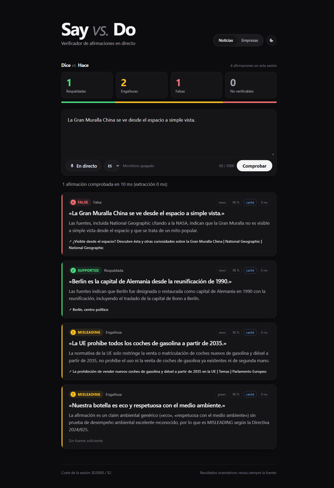

# Say vs. Do

**Live fact-checking for what people say — speeches, interviews, ads and corporate "green" claims — with sources, in seconds.**

Built solo by **Brayan Anaya** at **Nebius × NVIDIA Build Week, Berlin (18 Oct 2026)**.



## The problem

Claims are made live — on stage, on TV, in a product ad — and checked days later, if ever. Meanwhile companies keep using vague "eco" and "climate-neutral" claims that the new **EU Directive 2024/825** (Empowering Consumers for the Green Transition) now treats as misleading.

## What it does

Paste a transcript, paste **the link to a news article**, or press **En directo** (live microphone). Say vs. Do:

1. finds the checkable claims in the text (numbers, dates, events, product and environmental claims),
2. searches the web for evidence,
3. gives each claim a verdict with a link to the source:

| Verdict | Meaning |
|---|---|
| ✓ **SUPPORTED** | the sources confirm it |
| ! **MISLEADING** | partly true, exaggerated or missing context |
| ✕ **FALSE** | the sources establish an incompatible fact |
| ? **UNVERIFIABLE** | not enough evidence — the app never guesses |

Two modes:

- **Noticias** (news / politics) — general fact-checking.
- **Empresas** (companies) — also applies the EU 2024/825 rules on green claims: generic "eco/green" claims without proof, climate neutrality through carbon offsets, whole-product claims that only apply to a part, future "net zero" promises without a verifiable plan, uncertified labels, legal requirements presented as features.

The UI shows a **"Dice vs. Hace" score panel** (verdict counts for the session), a **pending card with a live millisecond timer** for each text being checked, the **latency of each claim**, and a light/dark theme. Works in Spanish, German and English.

## How it works

```
mic (Web Speech API) or pasted text
        │
        â–¼
 Nemotron: extract claims  ──▶  Tavily: search evidence (top 5)  ──▶  Nemotron: verdict + source
  (schema-constrained JSON)        (untrusted data, sanitized)          (schema-constrained JSON)
        │                                                                  │
        └──────────── zod validation of every model reply ────────────────┘
                                         │
                                         â–¼
                 live verdict cards · score panel · demo cache · audit log
```

- **Model:** NVIDIA **Nemotron 3.5 Super** served by **Nebius Token Factory** (`nvidia/Nemotron-3.5-Super-VL`, `https://api.tokenfactory.nebius.com/v1`) as the primary provider, with the **NVIDIA API** (`build.nvidia.com`, `nvidia/nemotron-3.5-super-vl-120b-a12b`) as an **automatic fallback** on timeout, rate limit (429), server error or network failure. Each card shows which provider gave the verdict ("Nemotron · Nebius Token Factory"). Base URLs and models come only from `.env`.
- **Structured output:** requests use `response_format: json_schema`, so the reasoning model always returns valid JSON. If a provider does not support it, the client falls back to plain JSON prompts automatically.
- **Evidence:** [Tavily](https://tavily.com) search, 5 results per claim.
- **News links:** if the input is a single link, **Tavily Extract** reads the article (first 6000 chars, shown with its title and domain) and its claims are checked like a transcript. Our server never fetches the URL itself (no SSRF); private/loopback hosts and non-http(s) schemes are refused.
- **Server:** Node.js + Express. **Frontend:** plain HTML/CSS/JS, no framework, no CDN, system fonts.
- **Demo cache:** real verdicts are saved in `cache/claims.json` (keyed by a SHA-256 of mode + normalized text). A repeated text comes back instantly **without any network call**, so a live demo survives bad Wi-Fi. Only valid, evidence-backed verdicts are cached, and never in mock mode.

## Results

Evaluation with the real APIs on 12 claims with a known answer (DE / EN / ES, both modes; `npm run eval`):

| Provider (Nemotron 3.5 Super) | Accuracy | Eval run time |
|---|---|---|
| **Nebius Token Factory** (primary) | **12 / 12 (100 %)** | 66 s |
| NVIDIA API (fallback) | 10 / 12 (83 %) | 144 s |

The NVIDIA misses were cautious **UNVERIFIABLE** answers; no false claim was marked as true by either provider.

Example from the live app:

- "Alemania generó en 2025 el 60 % de su electricidad con renovables." → **MISLEADING** — sources report 58.6 % (Enerdata).
- "La Torre Eiffel está en Berlín." → **FALSE** — it is in Paris (Wikipedia).

Typical latency for a new text: a few seconds on Nebius Token Factory, 10–30 s on the NVIDIA fallback; ~10 ms from the cache.

## Security

| Measure | Where |
|---|---|
| API keys only in `.env` (gitignored), never sent to the browser, never logged; startup prints only `true/false` per variable | `src/config.js`, `src/index.js` |
| All input validated with zod (text ≤ 5000 chars, unknown fields rejected), request body ≤ 32 KB | `src/schemas.js`, `src/server.js` |
| Every model reply validated with zod; invalid output → UNVERIFIABLE, never passed on | `src/pipeline.js` |
| Prompt-injection defence: transcripts and Tavily results are **untrusted data**, placed in separate user messages inside `<untrusted_data>` tags (tags inside the data are neutralized); the system prompt is constant | `src/prompts.js` |
| The source link can only be one of the real search-result URLs (http/https); the model cannot invent links | `src/pipeline.js`, `src/schemas.js` |
| Rate limit 20 requests/min per IP; timeouts (15 s search, 45 s reasoning model) with limited retries and exponential backoff | `src/server.js`, `src/http.js`, `src/config.js` |
| Spending cap per session and per server | `src/budget.js` |
| Audit log (`logs/`, gitignored): claim with PII masked (emails, phones, IBANs), source URLs, tokens, verdict, hashed session id — no keys | `src/audit.js` |
| helmet: CSP `default-src 'self'`, nosniff, no `x-powered-by`; errors without stack traces | `src/server.js` |
| Frontend never uses `innerHTML` (no XSS from model or source text) | `public/app.js` |
| Only allowlisted external hosts are called: the LLM base URLs from `.env` and `api.tavily.com`. The model cannot run code or touch the file system | `src/llm.js`, `src/pipeline.js` |

Known limits (demo build): no user accounts and no HTTPS (runs on localhost); the spending cap lives in memory; price defaults are conservative estimates.

### OWASP Top 10 (2025) review

| # | Risk | Status | How |
|---|---|---|---|
| A01 | Broken Access Control | N/A (by design) | No user accounts or per-user data: every visitor gets the same public checker. Session ids are random, only used for the spend cap, and hashed in logs. |
| A02 | Security Misconfiguration | Implemented | helmet with a strict CSP (`default-src 'self'`), nosniff, no `x-powered-by`; server binds to `127.0.0.1`; errors never return stack traces. |
| A03 | Software Supply Chain Failures | Implemented | 5 well-known direct dependencies, lockfile committed, `npm audit --omit=dev`: 0 vulnerabilities. Frontend loads no CDN or third-party scripts. |
| A04 | Cryptographic Failures | Partial | Outbound calls (LLM, Tavily) are HTTPS only. The local demo server itself is HTTP on localhost; production needs TLS (`upgrade-insecure-requests` is ready to re-enable). |
| A01+ | Server-Side Request Forgery (news links) | Implemented | The server never fetches user URLs: Tavily Extract does. Only single public http(s) links are accepted; localhost, private and link-local IPs, credentials in URLs and other schemes are refused (`src/article.js`, tested). |
| A05 | Injection | Implemented | No SQL / shell / eval. All input validated with zod (strict schema, size limits); untrusted text is never interpreted as code; the DOM is built with `textContent` only (no XSS). |
| A06 | Insecure Design | Implemented | Threat-driven design: untrusted data separated from instructions, fail-safe verdicts (invalid → UNVERIFIABLE), mock mode never invents verdicts, rate limit and spend caps per session and per server. |
| A07 | Authentication Failures | N/A | No logins or passwords. API keys stay server-side in `.env` and are validated at startup (only `true/false` is printed). |
| A08 | Software or Data Integrity Failures | Implemented | Model output and search results are schema-validated; the source link must be one of the real search URLs; the cache only stores validated, evidence-backed verdicts and ignores corrupted files. |
| A09 | Security Logging & Alerting Failures | Partial | Audit log of every verdict (claim with PII masked, sources, tokens, provider fallback warnings, cache hits). No alerting — out of scope for a demo. |
| A10 | Mishandling of Exceptional Conditions | Implemented | Timeouts, limited retries with backoff, provider fallback; any failure ends as UNVERIFIABLE or a clean JSON error; body-parser errors return 400/413 without details. |

### OWASP Top 10 for LLM Applications (2025) review

| # | Risk | Status | How |
|---|---|---|---|
| LLM01 | Prompt Injection | Implemented | Constant system prompts; transcripts and web results go in separate user messages inside `<untrusted_data>` (tags in the data are neutralized); tested with injection payloads (`test/security.test.js`). |
| LLM02 | Sensitive Information Disclosure | Implemented | Keys never reach the model, the browser or logs; PII (emails, phones, IBANs) is masked in the audit log; raw source text is not sent to the browser. |
| LLM03 | Supply Chain | Implemented | Hosted Nemotron models from Nebius Token Factory / NVIDIA (no self-downloaded weights); model ids pinned in `.env`; dependencies audited (see A03). |
| LLM04 | Data and Model Poisoning | Partial | No training or fine-tuning. Poisoned web pages are mitigated by multiple sources, URL allowlisting and "use only these sources" rules, but a false page could still mislead a verdict. |
| LLM05 | Improper Output Handling | Implemented | Schema-constrained decoding plus zod validation; output is rendered as text only; links must match a real search result. |
| LLM06 | Excessive Agency | Implemented | The model has no tools: it cannot browse, run code, write files or call APIs. The server decides every action. |
| LLM07 | System Prompt Leakage | Implemented | System prompts contain no secrets (they are public in this repo), so leaking them exposes nothing. |
| LLM08 | Vector and Embedding Weaknesses | N/A | No RAG vector store or embeddings are used. |
| LLM09 | Misinformation | Partial | Verdicts are grounded in cited sources, UNVERIFIABLE is the default when evidence is weak, and the UI says "revisa siempre la fuente". Eval: 12/12 (Nebius), 10/12 (NVIDIA); the model can still be wrong. |
| LLM10 | Unbounded Consumption | Implemented | Rate limit (20 req/min/IP), input ≤ 5000 chars, max 5 claims per request, `max_tokens` cap, timeouts, and spend caps per session and per server. |

## Run it

Requirements: Node.js 20+ (tested on 24), Google Chrome for the live microphone.

```bash
npm install
cp .env.example .env      # Windows: copy .env.example .env
# fill in .env (see below)
npm start                 # http://localhost:3000
npm test                  # 70 tests (node:test)
npm run eval              # accuracy on eval/claims.json with the real APIs
```

| `.env` variable | Purpose |
|---|---|
| `NEBIUS_API_KEY` | primary LLM key (Nebius Token Factory) |
| `NEBIUS_BASE_URL` | `https://api.tokenfactory.nebius.com/v1` (the app calls `{URL}/chat/completions`) |
| `NEMOTRON_MODEL` | `nvidia/Nemotron-3.5-Super-VL` |
| `NVIDIA_API_KEY` / `NVIDIA_BASE_URL` / `NVIDIA_MODEL` | optional fallback LLM, e.g. `https://integrate.api.nvidia.com/v1` + `nvidia/nemotron-3.5-super-vl-120b-a12b` |
| `TAVILY_API_KEY` | Tavily search key |
| `MAX_SESSION_COST_USD` / `MAX_TOTAL_COST_USD` | spending caps (defaults 2 / 10) |
| `LLM_USD_PER_1M_INPUT_TOKENS`, `..._OUTPUT_TOKENS`, `TAVILY_USD_PER_SEARCH` | prices used for the caps (conservative defaults 1 / 3 / 0.01) |
| `DEMO_CACHE` | `off` disables the demo cache |

**No keys?** The app still runs end to end in **MOCK mode**: the UI shows a MOCK badge and grey "DEMO" cards, and it **never shows an invented verdict**.

Helper scripts: `scripts/warm-cache.js` (send the demo sentences once so they are cached), `scripts/probe-model.js` / `scripts/probe-judge.js` / `scripts/probe-article.js` (debug the live model and link reading).

Privacy note: in Chrome, the Web Speech API sends audio to Google for transcription. Do not use real personal data in demos.

## API

- `GET /api/status` → `{ mock: { llm, search }, maxTextLength, maxSessionCostUsd }`
- `POST /api/check` with header `X-Session-Id` and body `{ "text": "...", "mode": "news" | "corporate", "lang": "de-DE" | "en-US" | "es-ES" }`
  → `{ mock, results: [{ claim, type, language, verdict, confidence, explanation, source_url, sources: [{ title, url }], latency_ms, cached?, cached_at? }], timing: { extract_ms, total_ms }, session_cost_usd, max_session_cost_usd }`

## License

MIT — see [LICENSE](LICENSE).
